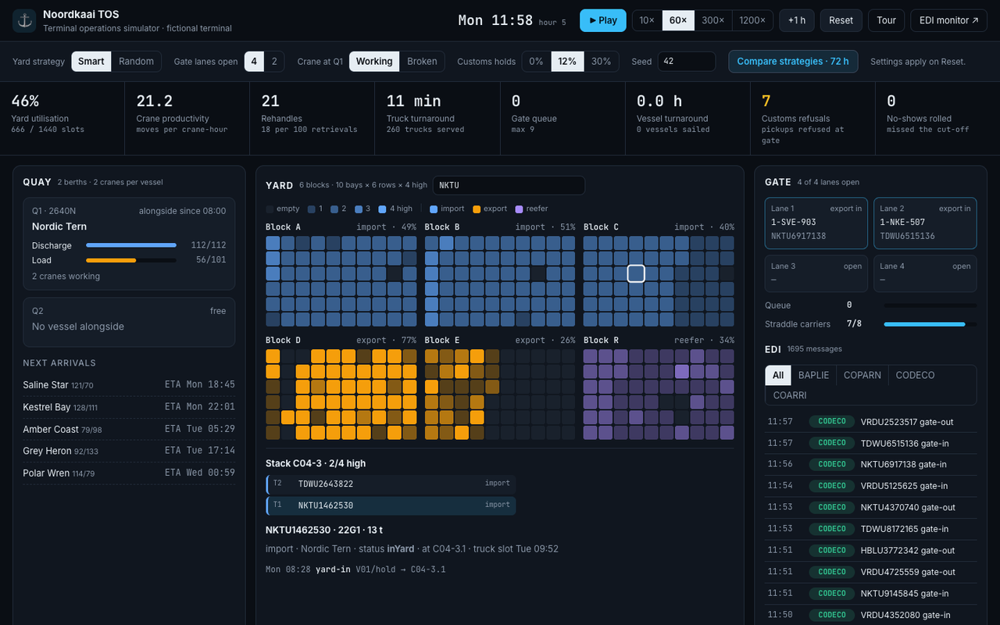

# Noordkaai TOS · terminal operations simulator

**A container terminal you can run in your browser.** Vessels announce themselves, berth and work with quay cranes; the yard fills and empties; trucks queue at the gate for their appointment; every move produces the EDIFACT message a real terminal would send. Then you break something and watch the numbers move.

**[▶ Open the simulator](https://phlppgdfry.github.io/terminal-operating-system-sim/)** · **[2-minute guided tour](https://phlppgdfry.github.io/terminal-operating-system-sim/?tour)** · **[EDI monitor](https://phlppgdfry.github.io/terminal-operating-system-sim/frontend/edi-monitor/)**

[](https://github.com/phlppgdfry/terminal-operating-system-sim/actions/workflows/ci.yml)



> Noordkaai Container Terminal is **fictional**. Vessels, containers, hauliers and carriers are generated. The model is deliberately simplified (see [Model and assumptions](docs/architecture.md)) and deterministic: the same seed always gives the same week.

## What you can do

| | |
|---|---|
| **Watch three days of operations** | 11 vessel calls, ~3,000 containers, ~1,600 trucks, at 10× to 1200× speed |
| **Follow one container** | search a number and see its stack, status, customs hold, truck slot and every move it made |
| **Look inside a stack** | click any square in the yard: which boxes, in which order, for which vessel and port |
| **Read the EDI** | BAPLIE, COPARN, CODECO and COARRI in UN/EDIFACT, each checked for envelope and segment count |
| **Break something** | random instead of smart yard allocation, two gate lanes closed, a crane down at Q1, more customs holds |
| **Prove a decision** | *Compare strategies* runs the same 72 hours twice and puts the KPIs side by side |
| **Take the data to BI** | download the move log as CSV in the shape of `MOVE_EVENT` in the [Oracle schema](database/schema.sql) |

## What the model shows

Median over seeds 1–8 and 42, 72 hours, default settings:

| KPI | Random allocation | Smart allocation |
|---|---|---|
| Rehandles per 100 retrievals | ~137 | **~45** |
| Crane productivity (moves per crane-hour) | ~14.6 | **~20.4** |
| Vessel turnaround | ~7.1 h | **~5.0 h** |
| Truck turnaround | ~12 min | ~11 min |

*Smart* keeps each vessel and port of discharge together in the export blocks, keeps import stacks low, and lets the crane take the box with the fewest containers on top first. With seed 42, closing two of four gate lanes takes truck turnaround from ~11 to ~43 minutes, and a broken crane at Q1 raises average vessel turnaround from ~5 to ~8 hours.

The tests in [`tests/engine.test.mjs`](tests/engine.test.mjs) assert these directions on every push, so the claims above cannot drift from the model.

## Run it locally

No build step, no dependencies.

```bash
git clone https://github.com/phlppgdfry/terminal-operating-system-sim.git
cd terminal-operating-system-sim
python3 -m http.server 8000      # then open http://localhost:8000
npm test                         # node --test, Node 20+
```

## How it is built

```text
sim/engine.js   the terminal: schedule, berths, cranes, yard, gate, KPIs (pure, deterministic, no DOM)
sim/edi.js      EDIFACT builders (COPARN, CODECO, BAPLIE, COARRI) and a validator
app.js          the operator screen: renders the engine, scenarios, search, compare, tour
database/       Oracle reporting schema + a rehandle-rate view
frontend/edi-monitor/   stand-alone EDI message monitor
tests/          node:test suite: ISO 6346 check digits, yard physics, strategy effects, EDI validity
```

More in [docs/architecture.md](docs/architecture.md) and [docs/system-flow.md](docs/system-flow.md).

## License

MIT
